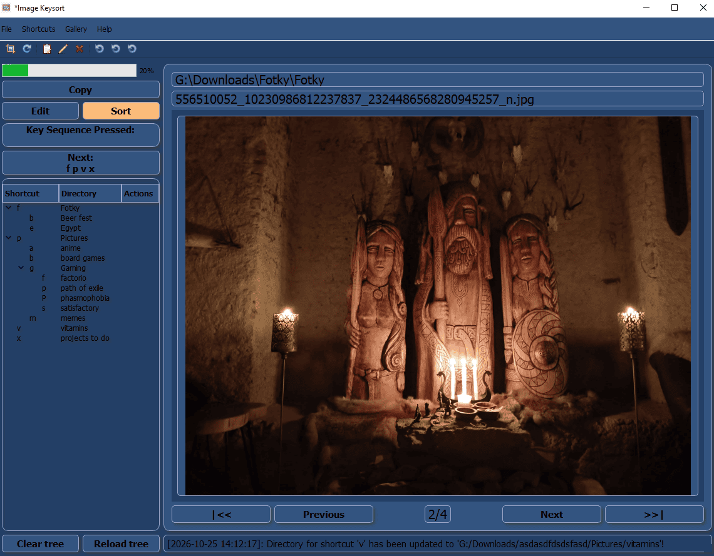

# Image Keysort



## 1. Description

Do you have directory with hundreds of screenshots, where every image belongs to different directory?

And even the thought of the repetitive sequence of opening the image, resolve where it belongs, open that directory and move it ONE BY ONE by hand make you tired?

This could help you, just as it helped me!


## 2. Tutorial

### 2.1. Add shortcut

1. Select EDIT mode (Ctrl+E or click on button)
2. Hit the desired shortcut, for example:
    - 'i' for 'images'
    - 'a' for 'anime'
    - 'n' for 'naruto'
3. Hit Enter and select destination directory, for example:
    - '/home/USER/Images/Anime/Naruto'
4. Select SORT mode (Ctrl+R or click on button)
5. Write the sequence, and by writing the last key, the image will be moved to the corresponding destination.

### 2.2. Update path of the existing shortcut

1. Select EDIT mode
2. Just add the same shortcut sequence again and select new path

OR

1. [TBD] Use Edit button beside the shortcut.


## 3. Features

- Select source directory for the gallery to be sorted
- 2 modes - SORT and EDIT
- Create shortcut and set destination directory for it
- Repeat last src-dst move by hitting '.'
- Undo the move
- Temporarily preserve part of the shortcut, so instead of repeating the whole 'ian', you can fix 'ia' and
  then hit just the last part of the sequence: 'n' for naruto, 'd' for deathnote and so on.
- Create a subset of gallery photos: Select Copy mode and just copy some photos to target directory, for example to
  show just subset of photos to your family.
- Crop images
  - Repeat previous crop on the same-sized images (e.g. multiple screenshots of the same page)
  - Undo crop
- Tags
  - Add custom tag(s) into the current file
- Rename files


## 4. How to build the app

### 4.1. Linux

1. xyz

    ```

    ```

### 4.2. Windows

1.  x

    ```

    ```


## 5. Known issues:

- Videos on Windows are playing, but are not shown in the player. Missing codecs/driver?


## 6. Run app manually

```shell
sudo dnf update
sudo dnf install make

# Run an app (requirements automatically installed in the python environment)
make run

# Cleanup everything
make clean
```


## 7. Contribution and development

Install dependencies locally (messy) or in python env.

- Install package dependencies

```shell
sudo dnf update
sudo dnf install \
python3-pip \
make
```

- Install pip dependencies:

```shell
pip3 install -r requirements.txt
```

- Make run

```shell
make run
```


## 8. Build a binary (exe) for Windows

Note: To create a working binary for Windows, those steps must happen on Windows (power shell), not linux subsystem!

- Ref windows-build.md


- 1. Create a .spec file (the first time we prepare a setup)
- 2. Install dependencies on the Windows's powershell:
    - `py -3.12 -m venv packenv`
    - `.\packenv\Scripts\python.exe -m pip install -r requirements.txt`
- 3. Build an exe file:
    - Must be done from PowerShell!
    - `pyinstaller.exe --clean --noconfirm ImageKeysort.spec`
- 4. Confirm that app is working by running an exe: `dist/ImageKeysort/ImageKeysort.exe`


- [ ] inno
- [ ] Installation (registry entry)
- [ ] Uninstall (registry out)
- [ ] Run without installation - Portable variant


### 8.1. Create an installer with Inno Setup app

- 0. Install Inno Setup
    - A) via Powershell (CLI):
        - `winget install --id JRSoftware.InnoSetup.7 -e -s winget -i`
    - B) via installer
        - https://jrsoftware.org/isinfo.php
- 1. Create .iss file (the first time we prepare a setup)
- 2. Ref steps above
- 3. Create an installer with Inno Setup 
    - A) GUI
        - 3.1. Open .iss file in Inno Setup
        - 3.2. Top Menu -> Build -> Compile
    - B) CLI
        - Must be done in PowerShell!
        - `ISCC.exe ImageKeysort.iss`
        - `& 'C:\Program Files\Inno Setup 7\ISCC.exe' ImageKeysort.iss`  sometimes fullpath is needed to the exe.
- 4. We get `dist-installer/ImageKeysort-Setup-x.y.z.exe`
- 5. Attach to GitHub Release


- Links:
    - Inno Setup page: https://jrsoftware.org/isdl.php
    

## 9. Build a package for Linux

- TODO


## Third-party assets

This application uses [Fugue Icons](https://p.yusukekamiyamane.com/)
by Yusuke Kamiyamane, licensed under
[CC BY 3.0](https://creativecommons.org/licenses/by/3.0/).

See [THIRD_PARTY_LICENSES.md](THIRD_PARTY_LICENSES.md)
for details.
